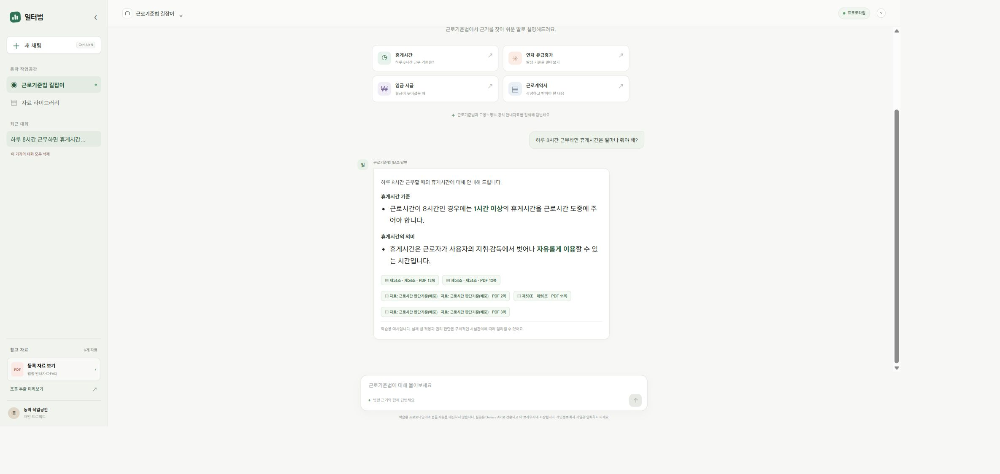
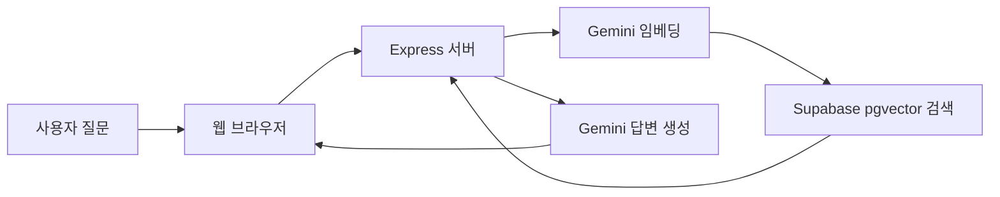

<div align="center">

<h1>일터법 · v0.1.0</h1>

<h3>근로기준법과 공식 자료를 찾아, 일하는 사람의 질문에 쉬운 말로 답해요</h3>

<p>근거 조항과 참고 문서를 함께 보여주는 RAG 챗봇 개인 프로젝트</p>

<p><a href="#주요-기능">주요 기능</a> · <a href="#화면-미리보기">화면 미리보기</a> · <a href="#로컬에서-실행하기">로컬에서 실행하기</a> · <a href="#기술-스택">기술 스택</a></p>

<br />


</div>

---

## 프로젝트 소개

**일터법**은 근로시간, 휴게시간, 임금, 연차, 근로계약 등 노동 관련 질문에 답하는 RAG 챗봇 개인 프로젝트입니다. 등록한 법령과 안내자료에서 관련 근거를 검색하고, 그 내용을 바탕으로 이해하기 쉬운 답변을 생성합니다.

> 법령 원문과 참고 자료를 함께 확인할 수 있도록 만들었습니다. 이 프로젝트는 학습용 프로토타입이며 법률 자문이나 개별 사건의 법적 판단을 제공하지 않습니다.

## 주요 기능

- PDF와 FAQ 자료를 검색해 질문에 맞는 근거를 찾는 RAG
- 답변에 참고 자료, 조문 정보, PDF 페이지 표시
- 조문 추출 미리보기와 참고 자료 라이브러리
- 대화 목록과 메시지를 현재 브라우저에 저장
- Supabase PostgreSQL과 pgvector를 이용한 문서 청크 저장 및 유사도 검색

## 화면 미리보기

### 전체 화면

사이드바, 참고 자료 영역, 채팅 화면을 한 번에 볼 수 있는 전체 화면입니다.



질문에 대해 쉬운 설명을 제공하고, 답변 아래에 사용한 법령·자료와 페이지를 표시합니다.


*로컬 앱에서 일반적인 휴게시간 질문으로 생성한 예시입니다.*

### 참고 자료 라이브러리

등록된 법령 PDF와 고용노동부 FAQ를 목록에서 확인할 수 있습니다.


### 조문 추출 미리보기

근로기준법 PDF에서 추출한 페이지 수, 글자 수, 조문 수와 조문별 텍스트 조각을 미리 확인할 수 있습니다.


## 동작 구조



문서 추가나 변경 시에는 로컬 수집 스크립트가 PDF/FAQ 내용을 청크로 나누고 임베딩을 만든 뒤 Supabase에 저장합니다. 사용자가 질문할 때마다 전체 문서를 다시 임베딩하지는 않습니다.

## 로컬에서 실행하기

### 준비물

- Git
- [Node.js **22.13.0 이상**](https://nodejs.org/en/download)
- Supabase 계정과 프로젝트
- Google AI Studio Gemini API 키

### 1. 저장소 내려받기

현재 GitHub 저장소가 비공개라면 저장소 소유자에게 접근 권한을 받아야 합니다.

```powershell
git clone https://github.com/Dong-DDack/workplace-law-chatbot.git
cd workplace-law-chatbot
```

### 2. Supabase 스키마 만들기

새 Supabase 프로젝트를 사용하는 경우 Dashboard의 **SQL Editor**에서 저장소의 [`supabase/schema.sql`](supabase/schema.sql) 내용을 열어 전체 실행합니다. 문서 테이블, 청크 테이블, 벡터 인덱스, `match_law_chunks` 검색 함수가 생성됩니다.

Supabase 프로젝트의 **Project URL**은 **Connect**에서, 서버용 **Secret key**(`sb_secret_...`)는 **Settings → API Keys**에서 확인해 둡니다. 3단계에서 `.env`를 만들 때 URL과 키를 입력합니다. 아래 예시의 `SUPABASE_SERVICE_ROLE_KEY`는 앱이 현재 읽는 환경변수 이름이므로, 여기에 새 Secret key 값을 입력하면 됩니다. 예전 `service_role` 키를 쓰는 기존 프로젝트도 동작하지만, 새 프로젝트에는 Secret key를 사용하세요.

> 이 프로젝트의 Gemini 임베딩은 **768차원**입니다. 다른 차원의 임베딩으로 바꾸면 SQL의 벡터 차원도 맞춰야 합니다.

Gemini API 키는 [Google AI Studio API Keys](https://aistudio.google.com/app/apikey)에서 만듭니다.

### 3. 환경변수 파일 준비하기

PowerShell에서 저장소 루트에서 아래 명령을 실행합니다. 이미 `main/.env`를 만들어 두었다면 복사 단계는 건너뛰고 값을 확인하면 됩니다.

```powershell
cd main
if (-not (Test-Path .env)) { Copy-Item .env.example .env }
notepad .env
```

`.env`에 본인 값들을 입력합니다.

```dotenv
GEMINI_API_KEY=본인의_Gemini_API_키
GEMINI_MODEL=gemini-3.5-flash-lite
SUPABASE_URL=https://프로젝트ID.supabase.co
SUPABASE_SERVICE_ROLE_KEY=본인의_Supabase_Secret_key
APP_ACCESS_USERNAME=tester
APP_ACCESS_PASSWORD=
```

환경변수 이름은 기존 코드와의 호환 때문에 `SUPABASE_SERVICE_ROLE_KEY`로 되어 있지만, 새 프로젝트에서는 위에서 안내한 `sb_secret_...` Secret key 값을 넣으면 됩니다. 이 키는 데이터베이스에 높은 권한을 주므로 브라우저 코드, GitHub, 공개 채팅에 올리지 마세요. `.env`는 Git에서 제외되지만, 커밋 전에 `git status`로 포함되지 않았는지 확인하세요. 로컬에서 비밀번호 입력을 원하지 않으면 `APP_ACCESS_PASSWORD`는 비워 두면 됩니다.

### 4. 패키지 설치하기

처음 실행하거나 의존성 설치가 필요할 때 한 번 실행합니다.

```powershell
npm.cmd ci
```

Windows PowerShell에서 `npm` 실행 정책 오류가 나면 `npm` 대신 `npm.cmd`를 사용하면 됩니다.

macOS/Linux에서는 `.env` 준비에 `cp .env.example .env`를 사용하고, 아래 명령에서 `npm.cmd` 대신 `npm`을 사용하세요.

### 5. 내 Supabase에 자료 임베딩하기

새 Supabase에는 문서가 없으므로, 패키지 설치 후 아래 명령을 실행해 PDF와 FAQ를 본인 DB에 저장합니다. PDF 원본은 저장소 루트의 `법령/`, FAQ 원본은 `main/data/labor-law-faq.json`에 있습니다. 자료를 추가하거나 수정한 뒤에도 다시 실행합니다. 이미 문서가 들어 있는 Supabase를 연결했다면 생략할 수 있습니다.

```powershell
npm.cmd run ingest
```

임베딩에는 본인의 Gemini API 사용량이 들며 무료 사용량·분당 요청 제한이 적용될 수 있습니다. 이미 자료가 들어 있는 Supabase를 연결했다면 다시 실행할 필요가 없습니다.

수집 스크립트는 임시 안내나 보도자료로 판단한 PDF를 파일명 기준으로 건너뛸 수 있습니다. 실행 로그의 제외·건너뜀 안내와 최종 자료·청크 수를 확인하세요. PDF.js는 PDF에 들어 있는 텍스트를 추출합니다. 이미지로 스캔된 PDF는 텍스트가 빠질 수 있고, 이 프로젝트는 OCR을 자동 실행하지 않습니다. 수집 중 텍스트가 거의 없는 페이지가 안내되면 OCR 처리된 PDF를 준비해야 합니다.

### 6. 앱 실행하기

```powershell
npm.cmd start
```

브라우저에서 [http://localhost:3000](http://localhost:3000)을 엽니다. 실행을 마치려면 PowerShell에서 `Ctrl+C`를 누릅니다.

## 데이터와 개인정보

- 문서 임베딩을 만들 때 추출한 문서 텍스트가 Gemini API로 전송됩니다. 질문할 때도 질문 임베딩 요청과 답변 생성 요청이 각각 발생하며, 답변 생성에는 질문과 검색된 문서 일부가 전달됩니다.
- 대화 기록은 서버나 Supabase가 아니라 해당 브라우저의 `localStorage`에 저장됩니다. 다른 기기나 브라우저와 동기화되지 않습니다.
- 문서 청크와 임베딩은 연결한 Supabase 프로젝트에 저장됩니다.
- 무료 Gemini API 서비스에서는 제출한 내용과 응답이 Google 제품 개선에 사용되거나 사람 검토자가 처리할 수 있다고 약관에 안내되어 있습니다. 개인정보, 회사 기밀, 민감한 사건 내용을 입력하지 마세요.
- 질문할 때마다 Gemini 임베딩·답변 API를 사용하므로 무료 한도 소진 후에는 요청이 실패할 수 있고, 유료 사용이면 비용이 발생할 수 있습니다.
- Gemini API 키와 Supabase Secret key는 서버 환경변수로만 관리합니다.

## 자료 기준과 한계

- 근로기준법 PDF는 저장소에 포함된 시점의 자료이며 자동으로 최신 법령으로 갱신되지 않습니다. 실제 상황에 적용하기 전에는 [국가법령정보센터](https://www.law.go.kr/)에서 현행 조문을 확인하세요.
- FAQ는 `main/data/labor-law-faq.json`에 저장된 선별 자료이며, 모든 노동 질문이나 관련 법령을 다루지 않습니다. 답변이 검색 자료에 없으면 정확한 판단을 제공하지 못할 수 있습니다.
- 새 PDF·FAQ를 추가해도 DB에 자동 반영되지 않습니다. 파일을 추가한 뒤 `npm.cmd run ingest`를 실행해야 합니다.
- 스캔본이나 표·복잡한 서식은 텍스트 추출과 검색이 부정확할 수 있습니다. 원문 PDF와 답변에 표시된 근거를 대조하세요.

## 배포를 진행하지 않는 이유

이 프로젝트는 Gemini API를 사용합니다. Google의 [Gemini API 추가 약관](https://ai.google.dev/gemini-api/terms)은 API를 전문·사업 목적의 개발에 사용하도록 하고 소비자용 사용은 제외하며, API 이용자는 만 18세 이상이어야 한다고 안내합니다. 또한 18세 미만을 대상으로 하거나 이들이 이용할 가능성이 높은 앱에서의 사용을 제한하고, 생성 결과를 법률 자문으로 의존하지 않도록 명시합니다. 노동법 안내 챗봇의 개인 포트폴리오 이용 범위와 예상 이용자 조건을 약관에 맞게 확인하지 못했기 때문에 외부에 배포하지 않고 로컬 사용으로 한정했습니다. 유료 API로 바꾸는 것만으로 이 사용 범위가 자동으로 해결되지는 않습니다.

## 디렉터리 구조

```text
.
├── 법령/                  # 원본 PDF 자료
├── supabase/
│   └── schema.sql         # Supabase 테이블과 벡터 검색 함수
├── main/
│   ├── data/              # FAQ 원본 데이터
│   ├── scripts/           # 문서 수집·임베딩 실행 스크립트
│   ├── src/               # PDF 파싱 및 RAG 서비스 코드
│   ├── app.js             # 브라우저 UI와 대화 동작
│   ├── server.js          # Express API 서버
│   └── .env.example       # 로컬 환경변수 예시
```

## 기술 스택

| 기술 | 프로젝트에서 하는 일 |
| --- | --- |
| HTML · CSS · Vanilla JavaScript | 채팅 UI, 대화 목록, 참고 자료 화면 |
| Node.js · Express | 웹 서버와 `/api/chat`, 자료 조회 API |
| Gemini API | 질문·문서 임베딩과 근거 기반 답변 생성 |
| Supabase PostgreSQL · pgvector | 문서 청크와 벡터 저장, 유사도 검색 |
| PDF.js | PDF에서 텍스트와 페이지 정보를 추출 |
| 직접 구현한 RAG 흐름 | 검색 결과를 프롬프트에 넣어 근거 중심 답변 구성 |

> 현재는 LangChain을 사용하지 않습니다. 검색·생성 흐름을 직접 연결해 RAG의 각 단계를 익히는 구성입니다.
