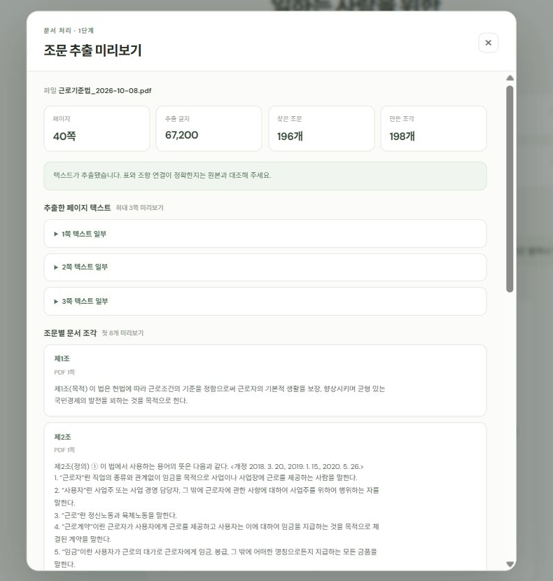
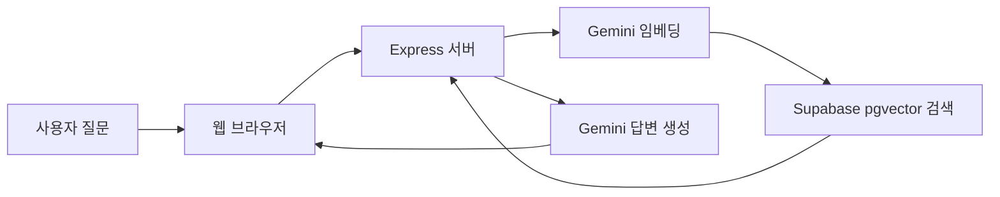

# 일터법

> 근로기준법과 고용노동부 공식 자료를 검색해, 일하는 사람의 질문에 쉬운 말로 답하는 RAG 챗봇 프로토타입

**현재 상태: 로컬 개발·제한 테스트 단계**  
실제 서비스 배포는 Gemini API 약관의 사용 범위를 확인한 뒤 결정합니다.

## 프로젝트 소개

일터법은 근로시간, 휴게시간, 임금, 연차, 근로계약 등 노동 관련 질문에 답할 때 등록된 법령과 안내자료를 검색하고, 찾은 근거를 바탕으로 답변을 작성합니다.

### 대화 예시

질문에 대해 쉬운 설명을 제공하고, 답변 아래에 사용한 법령·자료와 페이지를 표시합니다.


*로컬 앱에서 일반적인 휴게시간 질문으로 생성한 예시입니다.*

### 참고 자료 라이브러리

등록된 법령 PDF와 고용노동부 FAQ를 목록에서 확인할 수 있습니다.


### 조문 추출 미리보기

근로기준법 PDF에서 추출한 페이지 수, 글자 수, 조문 수와 조문별 텍스트 조각을 미리 확인할 수 있습니다.



### 주요 기능

- PDF와 FAQ 자료에서 관련 내용을 검색하는 RAG 흐름
- Supabase의 PostgreSQL 및 pgvector를 이용한 청크·임베딩 저장과 유사도 검색
- Gemini API를 이용한 임베딩과 답변 생성
- 답변에 참고 자료와 조문 정보를 표시
- 대화 목록과 대화 내용은 현재 사용 중인 브라우저의 로컬 저장소에 보관
- 테스터 접근 비밀번호, 질문 길이 제한, 분당 요청 제한을 갖춘 배포 준비 설정

> 이 프로젝트는 학습용 프로토타입입니다. 법률 자문이나 개별 사건의 법적 판단을 제공하지 않습니다.

## 동작 구조



문서 추가나 변경 시에는 로컬 수집 스크립트가 PDF/FAQ 내용을 청크로 나누고 임베딩을 만든 뒤 Supabase에 저장합니다. 사용자가 질문할 때마다 전체 문서를 다시 임베딩하지는 않습니다.

## 로컬 실행

### 준비물

- Node.js **22.13.0 이상**
- Supabase 프로젝트와 필요한 테이블·검색 함수
- Google AI Studio에서 발급한 Gemini API 키

### 1. 환경변수 파일 만들기

PowerShell에서 프로젝트의 `main` 폴더로 이동합니다.

```powershell
cd main
Copy-Item .env.example .env
notepad .env
```

`.env`에 본인 값들을 입력합니다.

```dotenv
GEMINI_API_KEY=본인의_Gemini_API_키
GEMINI_MODEL=gemini-3.5-flash-lite
SUPABASE_URL=https://프로젝트ID.supabase.co
SUPABASE_SERVICE_ROLE_KEY=본인의_Supabase_service_role_키
APP_ACCESS_USERNAME=tester
APP_ACCESS_PASSWORD=
```

`SUPABASE_SERVICE_ROLE_KEY`는 데이터베이스에 높은 권한을 가진 비밀키입니다. 브라우저 코드, GitHub, 공개 채팅에 넣지 마세요. `.env`는 Git에서 제외되지만, 커밋 전에 `git status`로 포함되지 않았는지 확인하세요.

### 2. 의존성 설치

```powershell
npm.cmd ci
```

Windows PowerShell에서 `npm` 실행 정책 오류가 나면 `npm` 대신 `npm.cmd`를 사용하면 됩니다.

### 3. 서버 실행

```powershell
npm.cmd start
```

브라우저에서 [http://localhost:3000](http://localhost:3000)을 엽니다. 서버를 종료하려면 PowerShell에서 `Ctrl+C`를 누릅니다.

## 문서 임베딩

현재 등록 자료의 임베딩은 Supabase에 저장되어 있으므로, **일반적인 로컬 실행에는 ingest를 다시 할 필요가 없습니다.** 새 PDF/FAQ를 추가하거나 내용을 바꿨을 때에만 실행하세요.

```powershell
npm.cmd run ingest
```

이 작업은 Gemini 임베딩 API 요청을 발생시키며, 무료 사용량과 분당 요청 제한을 소모할 수 있습니다. `법령/` 폴더의 자료와 `main/data/labor-law-faq.json`을 기준으로 처리합니다.

## 데이터와 개인정보

- 질문은 답변 생성을 위해 Gemini API로 전송됩니다.
- 대화 기록은 서버나 Supabase가 아니라 해당 브라우저의 `localStorage`에 저장됩니다. 다른 기기나 브라우저와 동기화되지 않습니다.
- 무료 Gemini API 서비스에서는 제출한 내용과 응답이 Google 제품 개선에 사용되거나 사람 검토자가 처리할 수 있다고 약관에 안내되어 있습니다. 개인정보, 회사 기밀, 민감한 사건 내용을 입력하지 마세요.
- 서버 API 키와 Supabase service-role 키는 서버 환경변수로만 관리합니다.

## 배포 상태와 Gemini 약관 확인

이 저장소에는 Render용 `render.yaml`과 테스터 비밀번호 보호 기능이 있습니다. 이는 배포 설정을 준비한 것이며, 현재 호스팅된 서비스가 있다는 뜻은 아닙니다.

Google의 [Gemini API 추가 약관](https://ai.google.dev/gemini-api/terms)은 Gemini API 사용을 전문적·사업적 목적의 개발로 설명하고 소비자용 사용은 제외한다고 명시합니다. 개인 포트폴리오 앱을 초대된 테스터에게 제공하는 경우가 이 범위에 포함되는지, 비밀번호 설정만으로 충분한지는 이 프로젝트에서 확정하지 않았습니다. Google의 확인을 받거나 사용 목적에 적합한 제공자를 선택한 뒤 배포를 진행합니다. 유료 API 사용도 이 사용 범위 문제를 자동으로 해결하지는 않습니다.

## 디렉터리 구조

```text
.
├── 법령/                  # 원본 PDF 자료
├── main/
│   ├── data/              # FAQ 원본 데이터
│   ├── scripts/           # 문서 수집·임베딩 실행 스크립트
│   ├── src/               # PDF 파싱 및 RAG 서비스 코드
│   ├── app.js             # 브라우저 UI와 대화 동작
│   ├── server.js          # Express API 서버
│   └── .env.example       # 로컬 환경변수 예시
└── render.yaml            # Render 배포 준비 설정
```

## 기술 구성

`Node.js` · `Express` · `Gemini API` · `Supabase PostgreSQL` · `pgvector` · `PDF.js`
